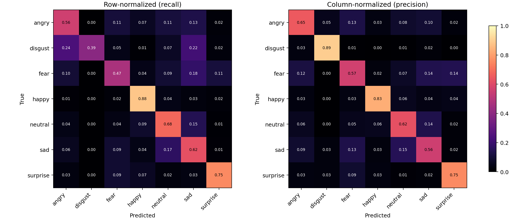

# Facial Expression Recognition

A seven-class PyTorch image classifier built around a duplicate-safe validation split, controlled ResNet-18 experiments, and a probability ensemble with horizontal-flip test-time augmentation.

The finished V2 experiment achieved **67.86% accuracy** and **0.6440 Macro F1** on a locked validation set of 5,741 images. These are saved validation results; hidden-test performance is unknown. The public repository contains source, experiment configurations, aggregate analysis, and prediction evidence. Dataset images and large model checkpoints remain external.

## What makes the experiment useful

- Exact decoded-pixel hashes keep duplicate images on the same side of the training/validation split.
- Conflicting-label duplicate groups are excluded from validation.
- Four experiments compare plain ResNet-18, label smoothing, augmentation, and training-only normalization.
- The selected ensemble averages three aligned probability vectors after per-member flip augmentation.
- Candidate selection uses validation accuracy first and Macro F1 as a tie-breaker; the hidden test set never drives selection.
- Saved prediction evidence lets a reviewer recompute the reported validation metrics without downloading images or training a model.

## Inspect the result

| Item | Location |
|---|---|
| Model, data, and limitations | [MODEL_CARD.md](MODEL_CARD.md) |
| Experiment narrative | [report.md](report.md) |
| Run ledger | [experiments/experiments.csv](experiments/experiments.csv) |
| Candidate ranking | [outputs/candidate_ranking.md](outputs/candidate_ranking.md) |
| Executed reviewer notebook | [notebooks/01_results_and_reproducibility.ipynb](notebooks/01_results_and_reproducibility.ipynb) |
| Training and evaluation code | [src/](src/) |



## Quick start

Use Python 3.12 and the recorded package versions:

```bash
git clone https://github.com/CodeAcc2007-dev/facial-expression-recognition.git
cd facial-expression-recognition
python -m venv .venv
source .venv/bin/activate
python -m pip install -r requirements.txt
python -m pytest -q
python tools/verify_public_evidence.py
```

The evidence verifier checks the saved candidate ranking, recomputes accuracy and Macro F1, validates probability sums and sample count, and checks recorded artifact hashes. It does not rerun training or hidden-test inference.

## Reproduce training

Obtain the organizer dataset through the [IITB ITC AI/ML team-selection competition](https://www.kaggle.com/competitions/iitb-itc-aiml-team-selection), subject to its access rules. Extract it into `data/raw/fer_challenge/` with `train.csv`, `test.csv`, `sample_submission.csv`, `train/`, and `test/` at that level.

```bash
python tools/run_audit.py
python -m src.train --config configs/01_resnet18_ce.json
python -m src.train --config configs/02_resnet18_smoothing.json
python -m src.train --config configs/03_resnet18_augment.json
python -m src.train --config configs/04_resnet18_graynorm.json
python tools/evaluate_tta.py --run-id r01_resnet18_ce
python tools/evaluate_tta.py --run-id r02_resnet18_smoothing
python tools/evaluate_tta.py --run-id r03_resnet18_augment
python tools/evaluate_tta.py --run-id r04_resnet18_graynorm
```

See `python tools/evaluate_validation_ensemble.py --help` for probability-ensemble evaluation and `python -m src.infer --help` for checkpoint inference. Training downloads the official torchvision pretrained weights once; the repository does not distribute organizer data or checkpoints. Rebuilding the original training and inference results requires the external dataset and freshly trained checkpoints.

## Limitations

The results come from one locked holdout, not multiple independent test sets. Duplicate hashes do not detect every near-duplicate. Expression categories do not establish a person's internal emotional state. This is an educational benchmark, unsuitable for hiring, diagnosis, surveillance, or other consequential decisions about people. See the model card for class-level performance and the full evaluation boundary.
